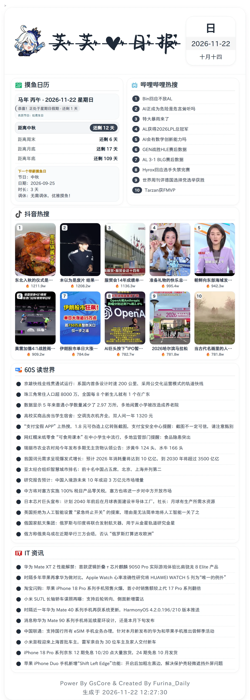
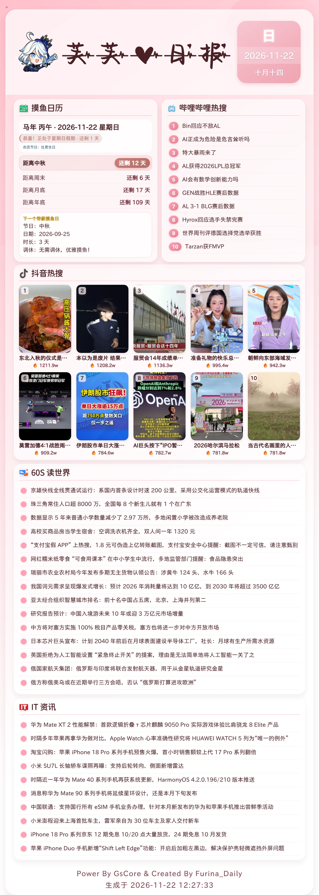

<p align="center">
  <a href="https://github.com/anyliew/Furina_Daily"></a>
</p>

# 芙芙日报 · Furina Daily

一款 [GsCore](https://github.com/gsuid-core/gsuid_core) 上的二次元风格、枫丹水神芙宁娜风格日报插件

基于[`anyliew/furina-daily`](https://github.com/anyliew/furina-daily) 的模板与数据设计实现。

每日自动生成精美日报图片：60s 读世界新闻、摸鱼日历、知乎/B站热搜、IT 资讯，以及抖音热搜/新番/头条三选一的海报热搜，
支持多主题、多群定时推送、定时刷新缓存、本地示例预览。

## 功能

- **定时推送**：可配置多个 Cron 时间点（默认 10:00、22:00），推送到已订阅会话（走 `gs_subscribe` 持久化，重启不丢）
- **定时刷新**：可配置多个 Cron 时间点（默认 07:30、09:30、17:30、21:00），到点后台预生成日报并刷新今日缓存，
  用户白天随时取图都命中缓存、秒回；失败连续 2 次才私聊告警主人
- **手动获取**：`日报` / `芙芙日报` / `今日日报` / `今日头条`，按日期 + 配置指纹智能缓存，配置改了自动失效
- **海报热搜**：下方海报区可切换「抖音热搜 / 今日新番 / 头条热搜」（新番取不到时自动回退抖音热搜）
- **侧栏话题**：知乎话题榜 或 哔哩哔哩热搜 二选一（默认哔哩哔哩热搜）
- **五套主题**：素白简讯（默认）/ 芙芙蓝色 / 真寻粉色 / 霜笺白鹭 / 绿野青穗
- **图片压缩**：默认关闭、原图直出；可选 PNG（无损）/ WebP（无损）压缩减小体积
- **自定义 API**：每个数据源可单独填地址；所有请求串行发起、相邻请求至少间隔 0.6 秒（不复用连接，避免给上游实例添并发压力），失败自动在内置公共实例池回退
- **渲染预览**：`日报模拟` 用内置示例数据按五套主题各出一份（不联网、不占今日缓存、不落盘）
- **数据源状态**：`日报数据源` 查看各模块当前实际使用的地址
- **帮助 / 配置**：`日报帮助` 出图；主人命令全部受权限保护

## 预览

以下五套主题预览均由 `日报模拟` 使用内置示例数据生成（不联网），原图见仓库 `Docs/Preview/` 目录（WebP，q88）。

<details>
<summary><b>素白简讯</b></summary>



</details>

<details>
<summary><b>芙芙蓝色</b></summary>


</details>

<details>
<summary><b>真寻粉色</b></summary>



</details>

<details>
<summary><b>霜笺白鹭</b></summary>


</details>

<details>
<summary><b>绿野青穗</b></summary>


</details>

## 安装

```bash
cd GsCore/gsuid_core/plugins/
git clone --depth 1 https://github.com/anyliew/Furina_Daily.git
```

插件把 HTML 渲染成图片依赖 Playwright，浏览器本体由 GsCore 框架统一处理，插件不做额外要求。

> Python 依赖（jinja2 / httpx / playwright / lunar-python / pillow）由框架按 `pyproject.toml` 自动安装；
> 需要手动安装时：`pip install jinja2 httpx playwright lunar-python pillow`

## 命令

前缀机制：插件允许空前缀，下列命令按字面直接触发。

| 命令 | 说明 | 权限 |
|------|------|------|
| `日报` / `芙芙日报` / `今日日报` / `今日头条` | 获取今日日报（智能缓存） | 所有人 |
| `日报帮助` | 帮助菜单出图（实时生成） | 所有人 |
| `日报数据源` | 查看各模块当前 API 地址 | 主人 |
| `开启日报推送` / `关闭日报推送` | 订阅 / 取消本群定时推送 | 主人（群聊） |
| `刷新日报` | 强制重新抓取并生成 | 主人 |
| `日报主题切换 <主题>` | 中文主题名（素白简讯/芙芙蓝色/真寻粉色/霜笺白鹭/绿野青穗），也兼容英文 code | 主人 |
| `海报切换抖音热搜` / `海报切换今日新番` / `海报切换头条热搜` | 切换海报热搜 | 主人 |
| `侧栏切换知乎话题榜` / `侧栏切换B站热搜` | 切换侧栏（别名：`侧栏切换知乎`、`侧栏切换b站热搜`、`侧栏切换哔哩哔哩热搜`） | 主人 |
| `日报压缩 开/关` | 压缩开关（不带参数则切换） | 主人 |
| `日报模拟` | 本地示例数据预览（五套主题） | 主人 |
| `日报清空配置` | 备份并恢复默认配置 | 主人 |

## 配置

在 GsCore WebConsole 的插件配置里可视化编辑，分为「推送配置 / 外观配置 / 内容配置 / 图片配置 / 数据源配置」。
推送时间与刷新时间改动后会在 1 分钟内自动重新注册定时任务，无需重启。关键项：

- `pushTimes`：推送时间，Cron 表达式列表，默认 `0 10 * * *` / `0 22 * * *`，至少一个、可自行增删
- `refreshTimes`：缓存刷新时间，Cron 表达式列表，默认 `30 7 * * *` / `30 9 * * *` / `30 17 * * *` / `0 21 * * *`，
  至少一个、可自行增删；到点只预生成图片、不发消息
- **推送对象（reportGroup）**：接收日报推送的群号列表，是唯一的配置来源——群内 `开启日报推送` / `关闭日报推送`
  自动维护，也可在 WebConsole 手动编辑；改动 1 分钟内自动同步订阅表（新增补订、移除退订），
  实际投递走 GsCore 订阅表，可在「订阅管理」页查看；留空表示没有群订阅
- `theme` / `hotModule` / `sideModule`：主题与板块（中文下拉；默认「素白简讯 / 抖音热搜 / 哔哩哔哩热搜」）
- `LOGO图片` / `标题字体` / `模块标题字体` / `正文字体`：可在 WebConsole 直接上传，文件保存在 `data/Furina_Daily/custom/`；留空或未上传时回退到插件内置资源
- `compressImage` / `compressFormat`：压缩开关与格式
- `api_*` / `proxy_bangumi`：各数据源地址与新番代理前缀

## 数据存放

插件运行期数据全部写入 GsCore 的 `data/` 目录，**不往插件目录写任何文件**（插件目录保持只读，方便 `git pull` 更新）。
以下路径均相对 `gsuid_core/` 根目录：

| 相对路径 | 内容 | 说明 |
|----------|------|------|
| `data/Furina_Daily/config.json` | 插件配置 | WebConsole 保存的全部配置（推送/刷新时间、**推送群列表**、主题、数据源等） |
| `data/Furina_Daily/output/` | 成品日报图 | `fufu-<日期>-<时间>.png/.webp`，自动只保留最近 3 张；渲染用的临时 HTML 也写在这里，截图完即删 |
| `data/Furina_Daily/cache/` | 帮助图临时文件 | `_help.html`，渲染完成即删 |
| `data/Furina_Daily/custom/` | 上传资源 | WebConsole 上传的 LOGO / 三套字体；留空或未上传时回退插件内置资源 |
| `data/Furina_Daily/daily_<时间戳>.json` | 配置备份 | `日报清空配置` 自动生成，只保留最近 5 份 |
| `data/GsData.db` | 推送订阅 | 订阅表是 `reportGroup` 的镜像（实际投递走这里）；重装插件不丢订阅 |
| `data/help/` | 帮助一览缓存 | GsCore 生成的 `Furina_Daily_*.jpg` 插件帮助图 |

只读资源随插件分发，在插件目录 `Furina_Daily/Furina_Daily/resource/` 下：`html/`（模板）、`font/`（字体）、`images/`、`svg/`、`mock/`（`日报模拟` 用的本地示例数据），随插件更新而更新。

## 结构

```
Furina_Daily/
├── pyproject.toml / ruff.toml / .gitignore / LICENSE / ICON.png / README.md
├── Docs/Preview/                  五套主题效果预览图（WebP）
└── Furina_Daily/                 内层包（嵌套加载）
    ├── __init__.py               Plugins(...) 声明
    ├── resource/                 只读资源：html 模板 / 字体 / 图片 / svg / mock 示例数据
    ├── utils/                    路径 / API 回退 / 日期 / 缓存指纹 / 格式化 / mock / 状态
    ├── config/                   CONFIG_DEFAULT + StringConfig
    ├── fetchers/                 httpx 抓取 + 8 个数据源 + 聚合
    ├── render/                   Jinja2 + Playwright 出图 + 帮助图
    ├── commands/                 命令触发器 + 日报缓存
    ├── push/                     APScheduler 定时推送 / 定时刷新 + gs_subscribe
    └── help/                     帮助注册与出图
```

## 致谢

- 上游 [`furina-daily`](https://github.com/anyliew/furina-daily) 的模板、字体与数据抓取设计
- [`vikiboss/60s`](https://github.com/vikiboss/60s) 提供新闻 / 摸鱼 / 热搜数据
- [`bangumi/api`](https://github.com/bangumi/api) 提供番剧日历

> 资源目录中的字体版权请自行确认，商用需替换为可商用字体或取得授权。
